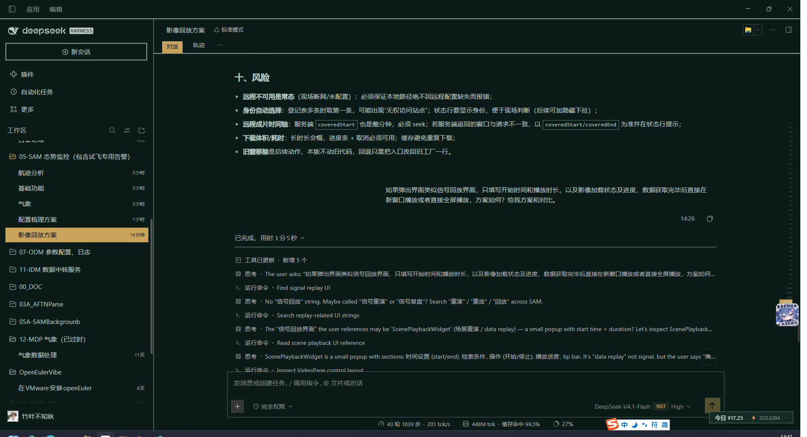

# 550C — DSH Plugin

这是一个 **DeepSeek Harness 插件（bundle）**，把 DSH Web GUI 换成《流浪地球》550C 控制台风格：
青黑表面、冷白遥测文字、单一琥珀指令色、直角与 2px 结构线。

安装后由 DSH 的插件系统加载（Host 半为空实现，Client 半负责皮肤），无需在设置里选择主题。



## 设计要点

| Token | 值 |
|---|---|
| 底色 `bg-base` | `#0A1B18` |
| 面板 `layer-1` | `#0D211E` |
| 面板 `layer-2`（设置页） | `#102623` |
| 弹层 `overlay` | `#142A27` |
| 结构线 `border-l1/l2` | `#5F7B74` / `#8CA39C` |
| 强调 `brand` | `#C9A45A` |
| 正文 `label-primary` | `#BCCBC5` |
| 次级文字 `label-secondary` | `#84988F` |

规则：全部直角；结构线 2px；选中态为琥珀实底 + `#07100D` 黑字；界面不出现中性灰底；日夜使用同一套色。

## 安装

从 GitHub 直接安装：

```bash
dsh plugin add https://github.com/jiangsuyuan/dsh-theme-550C
```

从 GitHub Packages 安装（需要带 `read:packages` 的 GitHub token，即使是公开包也要鉴权）：

```bash
npm config set @jiangsuyuan:registry https://npm.pkg.github.com
npm install @jiangsuyuan/dsh-theme-550c
```

也可以在 DSH 的插件管理里以本地目录安装 `dsh plugin install-bundle <path>`。安装后立即生效（常驻皮肤，无需在设置里选择主题）。

## 发布

```bash
npm publish --registry=https://npm.pkg.github.com
```

需先登录该 registry（`npm login --registry=https://npm.pkg.github.com --scope=@jiangsuyuan`），token 需具备 `write:packages`。

## 结构

```
client.js          # 客户端：token 覆盖层 + 常驻重绘 + 选中态/边框处理
index.js           # Host 空实现
cordis.patch.yml   # bundle patch
locale/*.json      # 插件标题与描述
icon.svg           # 插件图标
```

## 实现说明

- DSH 的主题 presenter 把 `--dsw-*` 写到 `document.body`，并用 `body[data-ds-dark-theme]` 切换组件规则。
  本插件在 `apply` 时写入自己的 token 值、强制打开 dark 规则、并在 `theme/change` 和定时器中重绘，保证浅色系统下也是同一套色。
- 第三方主题 id 不会进入 DSH 的设置持久化，所以这里没有用 `theme.register`，而是做 token 覆盖层。
- 选中态：页签、会话行、设置项按 `aria-selected` / `aria-checked` / `aria-pressed` / `data-state` 等状态上色，
  状态移除即恢复；另用一份登记表清理曾经写入的内联色，避免切换后残留黑字。
- 结构线：侧栏与对话区之间、标题栏下沿各一条 2px 线；输入框和代码块各自 2px 边框。

## 已知边界

- 不改变 DSH 的字体族与组件布局。
- 部分组件使用固定色（如个别图标），token 覆盖不到。
- DSH 升级若调整 token 或 DOM 结构，可能需要同步维护。

## License

MIT
